# Kotoba


On-screen keyboard (input method) for Android.

## Screenshots

<p>
  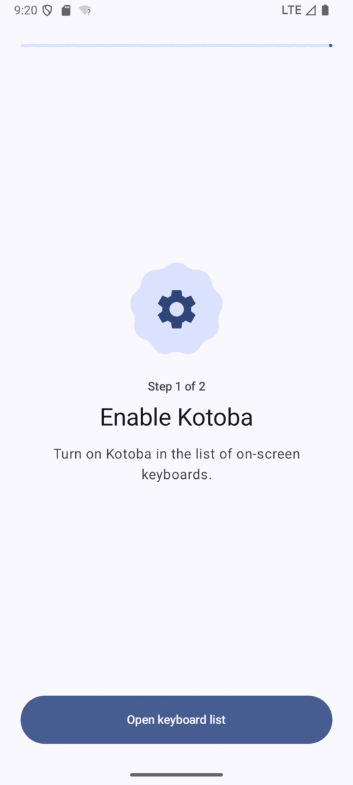
  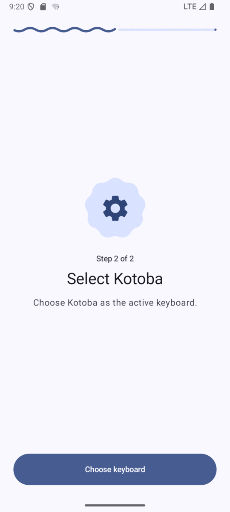
  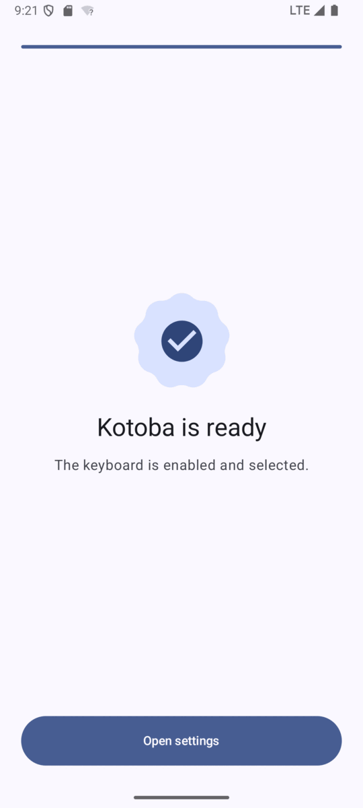
  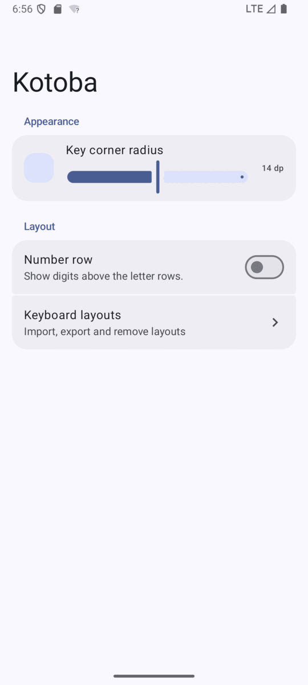
</p>
<p>
  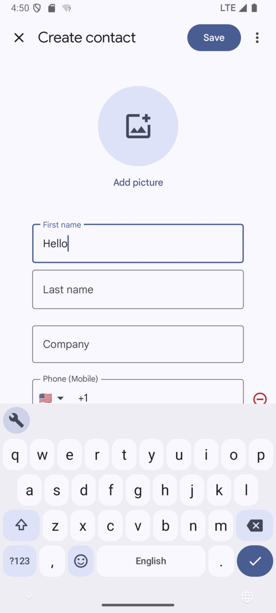
  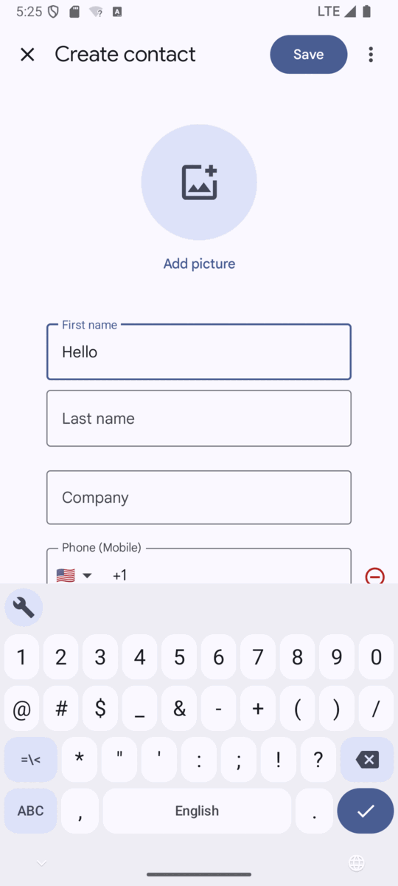
  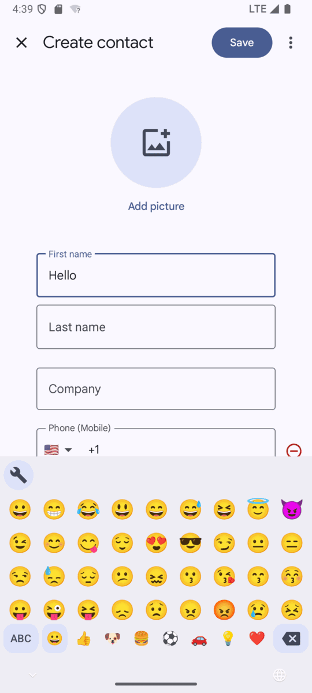
  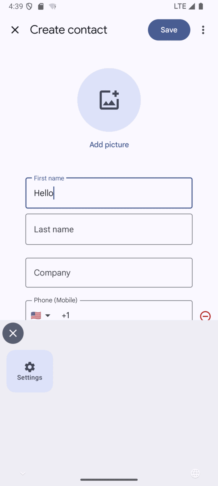
</p>
<p>
  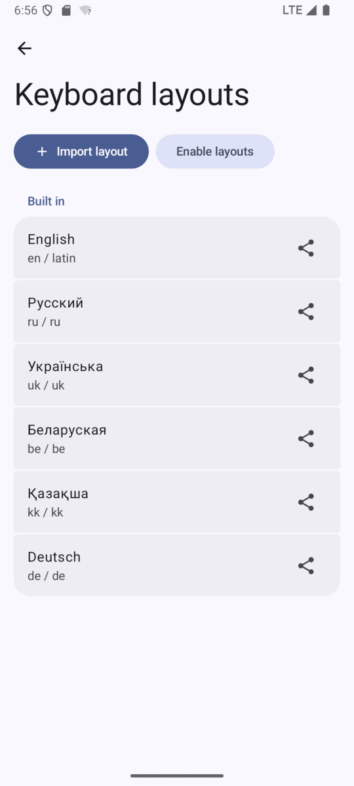
  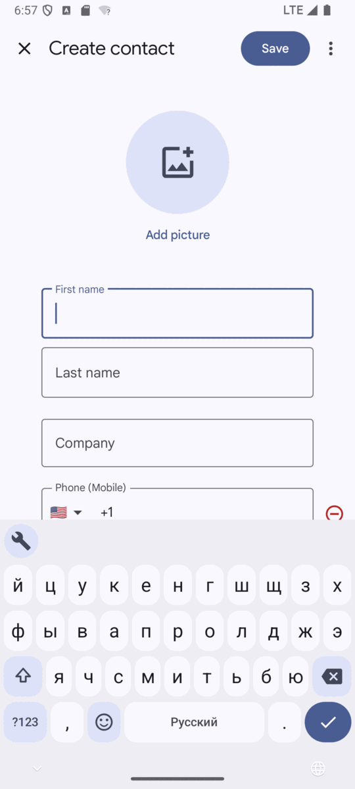
  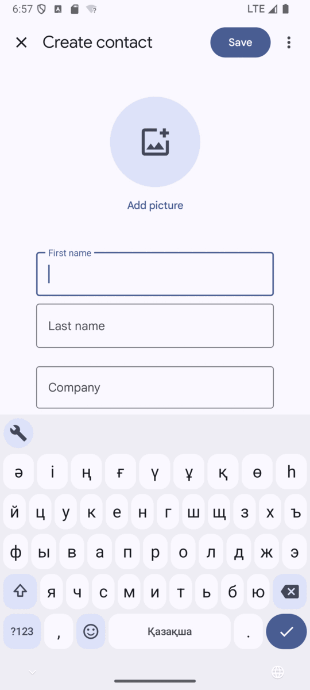
  
</p>

## Dependencies

- JDK 21
- Android SDK with platform 37 and build-tools 37
- Android 12 (API 31) or newer on the target device

## Build

Create `local.properties` in the project root and point it at the Android SDK:

```
sdk.dir=/path/to/Android/Sdk
```

Build the debug APK:

```
./gradlew assembleDebug
```

The APK is written to `app/build/outputs/apk/debug/app-debug.apk`. Install it with:

```
adb install -r app/build/outputs/apk/debug/app-debug.apk
```

## Releases

| Version | Codename  |
|---------|-----------|
| 0.1.0   | Yakushima |

## License

GPL-3.0-only. See [LICENSE](LICENSE).
